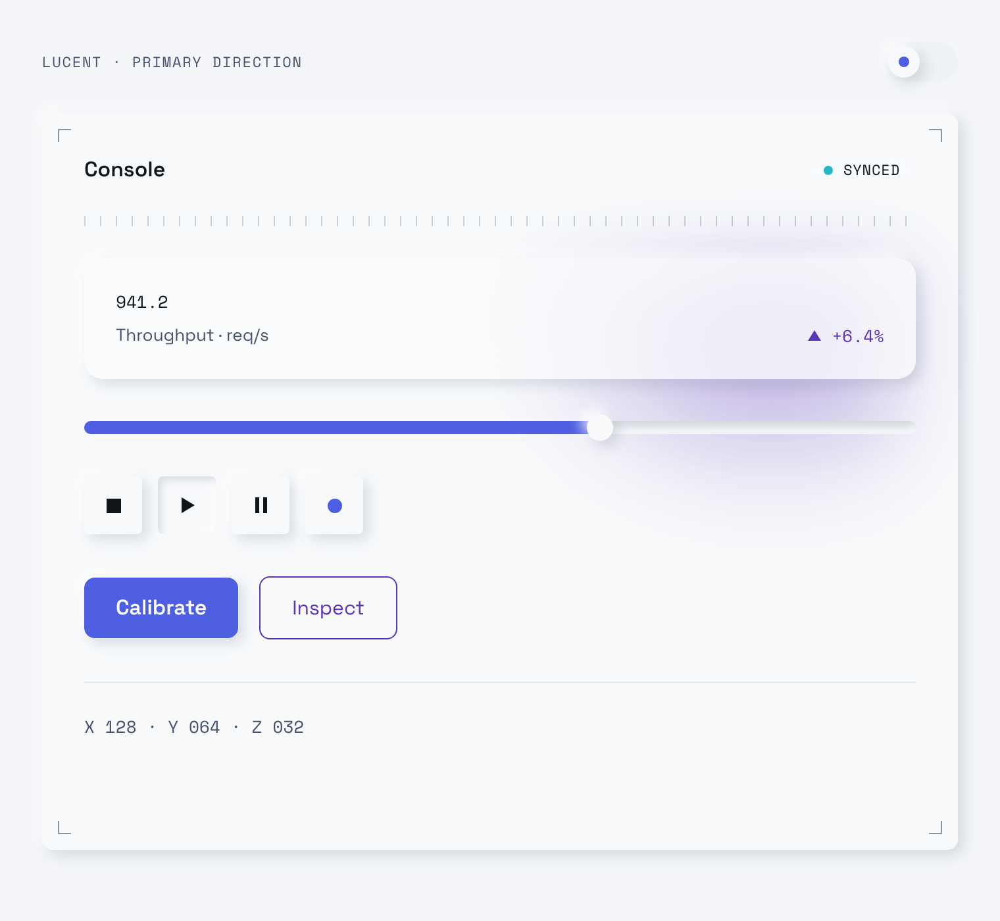
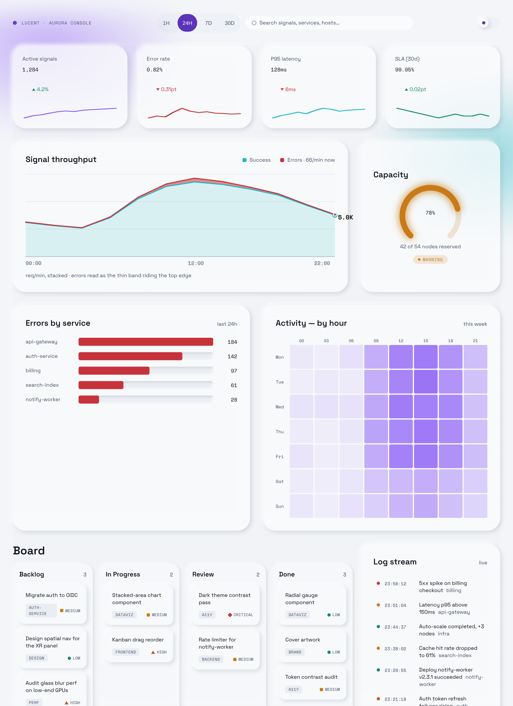
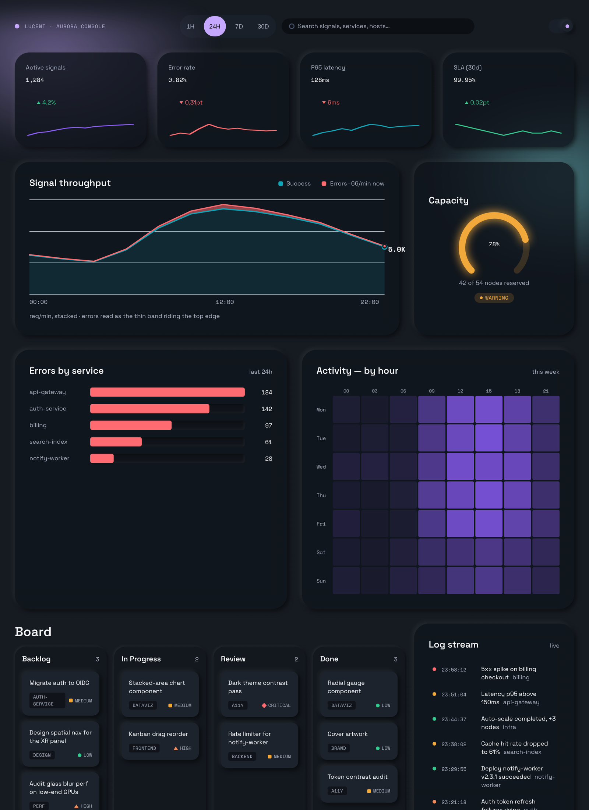
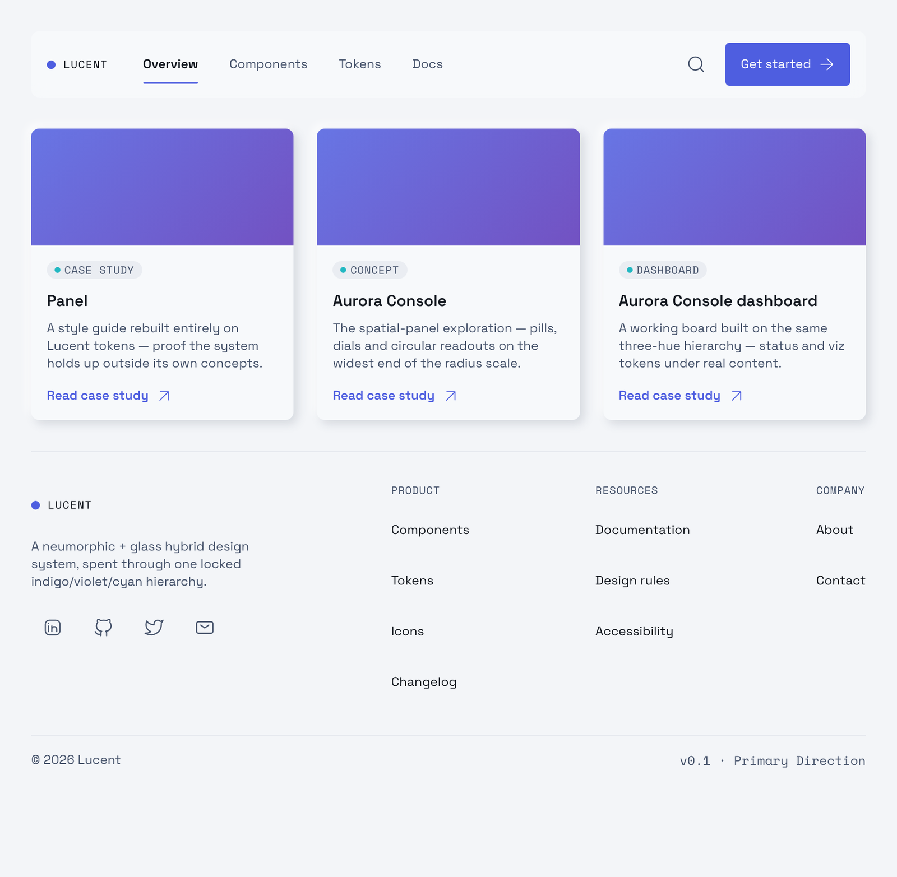
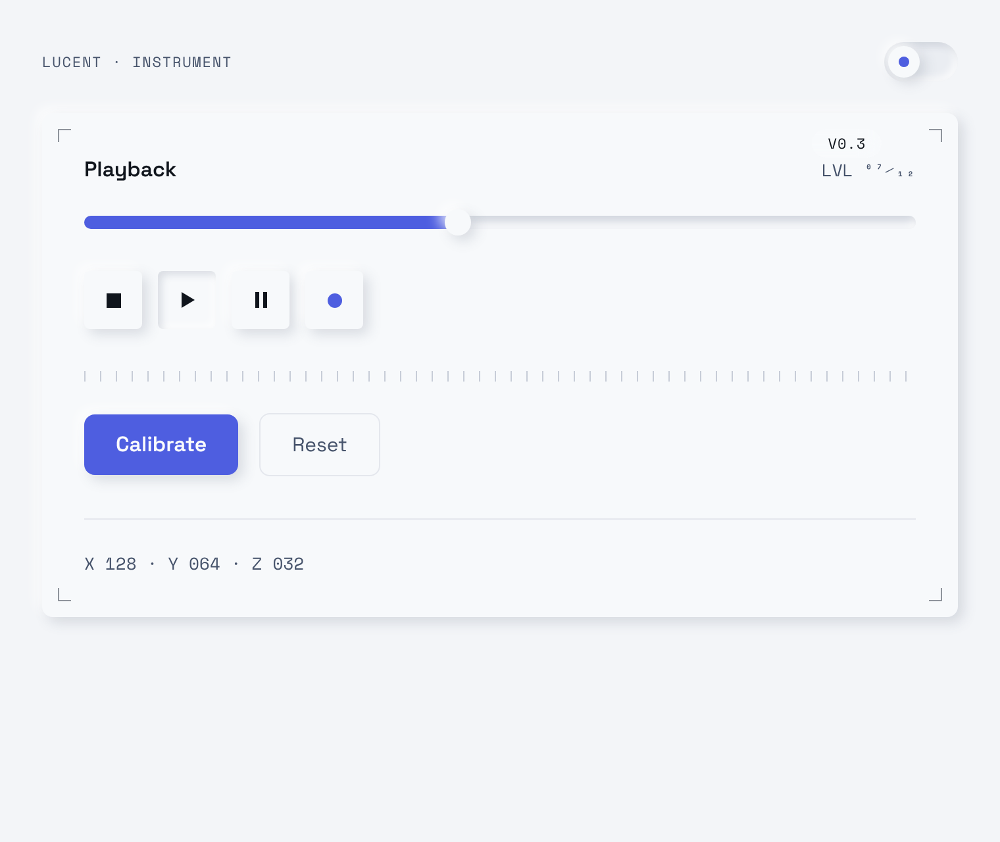
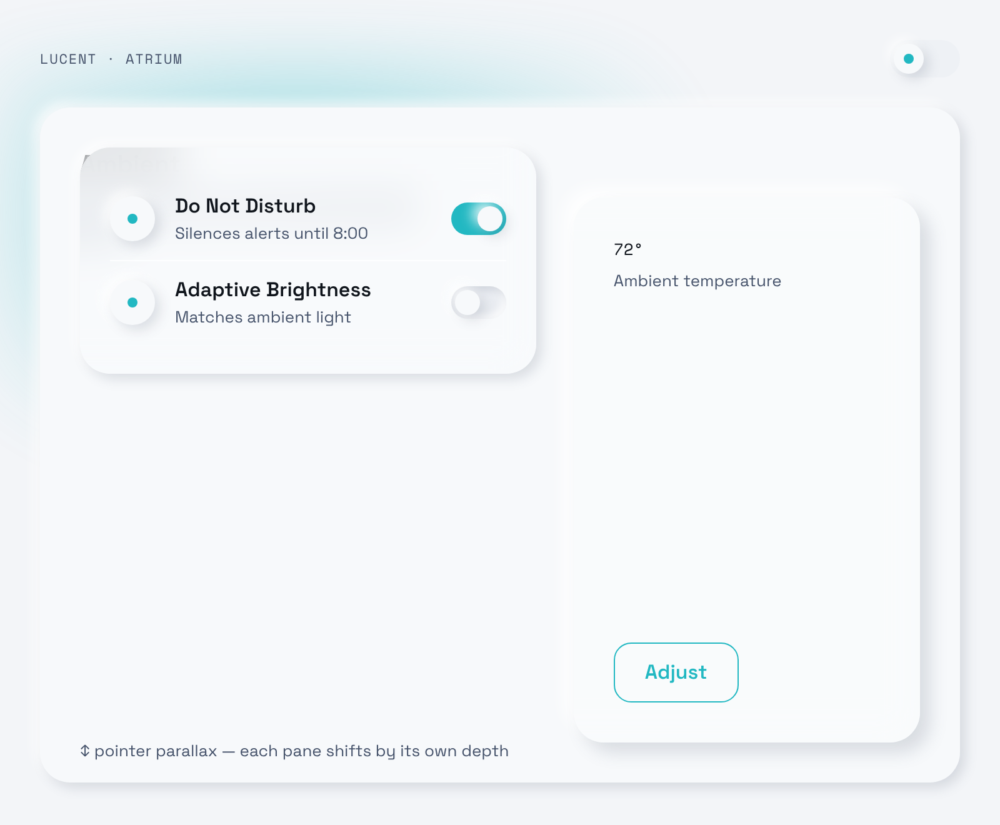
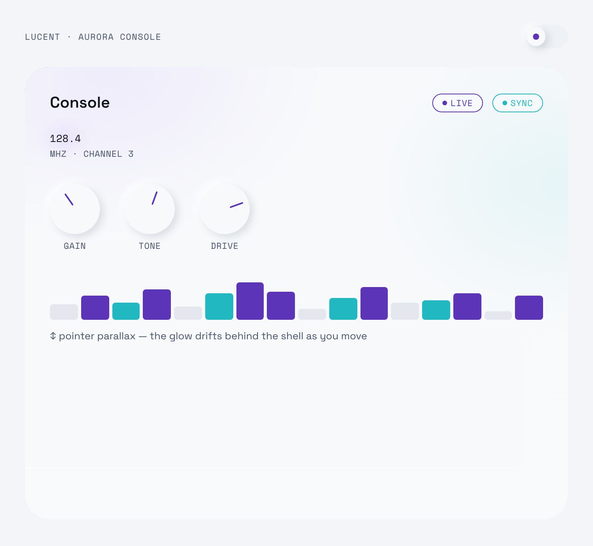

# Lucent DS

Lucent is a design system: one set of design tokens and a glass-over-neumorphic surface language, built to hold up in a web app, a mobile or tablet surface, a document or presentation, and a spatial panel. Version 0.5.0.

## What is here

- `project/tokens.json` is the single source for every token.
- `export/` holds the generated files: `tokens.css`, light and dark token JSON, `typography.json`, `motion.json` and a manifest with checksums. Do not edit these by hand.
- `project/components/` holds the concept explorations, the locked Primary Direction, a dashboard and the site-structure components. Open any `preview.html` in a browser.
- `project/icons/` is a set of 1,383 single-ink outline icons as one SVG sprite, with a manifest and a grep-friendly index.
- `project/fonts/` holds Space Grotesk and Space Mono, each under the SIL Open Font License 1.1 (licence texts sit beside the files).
- `project/README.md` is the full brand and usage guide.

## Applied examples

Each screenshot is a live `preview.html` from `project/components/`, rendered from the same `export/tokens.css`. Open any of them in a browser. Most carry their own light and dark switch.

### Primary Direction



The shipping identity. It keeps the structure and restraint of Concept A and adds the glass of Concept B, with three locked accents: indigo for the main action, violet for a second action or a live change, cyan for a small status mark.

### Dashboard

| Light | Dark |
|---|---|
|  |  |

A dense analytics and Kanban screen on one token set: stat tiles with sparklines, a stacked-area time series, a bar chart, a heatmap, a radial gauge, a board and a log stream. Chart marks use the `viz-series-*` tokens. Status colours always carry an icon and a label.

### Site structure



The chrome a real site needs: header and navigation, a project card, a footer. These are the first components to use the icon set, and the ones built to reflow down to a phone width.

### The three explorations

| Concept A, Instrument | Concept B, Atrium | Concept C, Aurora Console |
|---|---|---|
|  |  |  |
| Bare neumorphic control panel, one indigo accent, tight radii. | Glass panels floating over one soft base, a cyan accent, pointer parallax. | Dense layered glass with violet and cyan glow and console readouts. |

The Primary Direction came out of these three. They stay in the guide as the record of that exploration, and they share every token with it.

## Use the tokens

```html
<link rel="stylesheet" href="export/tokens.css">
<button style="background: var(--accent-primary); border-radius: var(--radius-sm); padding: var(--space-3) var(--space-5)">Save Layout</button>
```

`export/tokens.light.json` and `export/tokens.dark.json` carry the same values in the W3C design-tokens draft format for Style Dictionary, Tokens Studio or your own build step.

## Regenerating the export

```
python3 project/scripts/regen_tokens.py          # rebuild export/ from project/tokens.json
python3 project/scripts/regen_tokens.py --check  # fail if export/ is stale
python3 project/scripts/test_regen_tokens.py     # pipeline tests
```

## Notes

- A case study referenced by the `panel-*` tokens is not part of this release. Those tokens remain in the token set.
- No licence has been chosen for the system itself yet. Until one is added, all rights are reserved. The bundled fonts keep their own licence.
